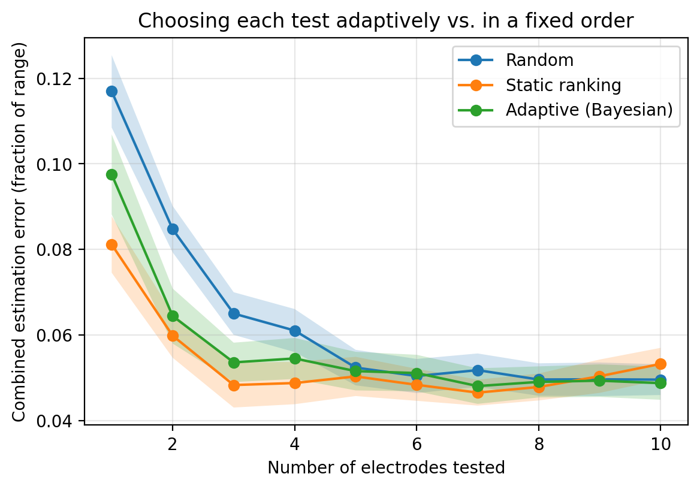

# Does Adaptive Bayesian Test Selection Speed Up Personalizing a Phosphene Model?
### Sequential Bayesian experimental design vs. fixed electrode orders, in simulation

Retinal prosthesis patients see differently shaped phosphenes, controlled in the axon map model
(Beyeler et al., 2019) by two patient-specific parameters, ρ and λ. Estimating them requires
testing electrodes one at a time, which is slow and tiring for patients. This follow-up to my
[phosphene personalization study](https://github.com/Bhuvan152/phosphene-personalization) asks:
**if we update a Bayesian belief after every test and choose the next electrode to maximize
expected information gain, do we need fewer tests than with a random or fixed order?**

## Setup
- **Simulator:** pulse2percept 0.11, Argus II (60 electrodes), axon map model. Each phosphene is
  summarized by area and elongation.
- **Prior:** uniform over a 9×9 grid of candidate patients (ρ = 100–500 µm, λ = 200–1400 µm).
- **Likelihood:** Gaussian on the two features with 15% relative noise plus a small floor
  (observations are simulated with 10% noise; the extra allows for patients between grid points).
- **Estimate:** posterior mean, which can fall between grid points.
- **Policies:** random order; a static ranking by expected information gain under the prior
  (computed once); and adaptive selection, recomputing expected information gain (Monte Carlo)
  after every test.
- **Evaluation:** 15 test patients with parameters off the grid, 4 noise repeats each (60 runs per
  policy), up to 10 tests; error = |ρ̂ − ρ|/400 + |λ̂ − λ|/1200.

## Results
**1. Choosing informative electrodes matters for the first few tests.** The static ranking
reduced error after one test by about 31% compared with random (0.081 vs. 0.117) and after three
tests by about 26% (0.048 vs. 0.065), with non-overlapping standard-error bands for tests 1–4.

**2. Adaptive Bayesian selection added no measurable benefit over the static ranking.** Their
standard-error bands overlapped from the second test onward. All three policies converged to an
error of about 0.05 after five tests.

**3. The most informative electrodes were consistent across methods.** Expected information gain
under the prior ranked E10, F10, A10, F7, E8, E9, F9, and B10 highest, the same bottom-row and
right-edge region identified empirically in my earlier study.

**4. A Bayesian estimate outperformed nearest-match fitting.** With one random electrode, error was
0.117 here versus 0.170 with nearest-match fitting in my earlier study on largely the same test
patients, though the finer grid (9×9 vs. 6×6) also contributes.

**Two explanations I tested and rejected:** more accurate information-gain estimates (200 instead
of 30 Monte Carlo samples) barely changed the adaptive policy, and a more cautious likelihood
(25% noise) made both policies slower to learn without improving final accuracy.

**Why adaptivity didn't help here (hypothesis):** with only two parameters, and the same electrodes
informative for every patient, the best next test barely depends on what has been learned.
Adaptive design should matter more for richer patient models, e.g., with implant position and
rotation as additional unknowns, where informative tests differ between patients.

## Limitations
- Simulation only; the same model generates and fits the data.
- Two shape features limit identifiability and likely set the ~0.05 error floor.
- Discrete 9×9 prior; a continuous model (e.g., a Gaussian process surrogate) would avoid grid effects.
- 60 runs per policy, and policies do not share noise draws; differences of ~0.01 are within noise.
- Greedy one-step information gain; non-myopic design was not tested.

## Reproducing
Open `bayesian_electrode_selection.ipynb` in Google Colab (`pip install pulse2percept`, v0.11).
Building the candidate library takes about 15 minutes.

## References
- Beyeler, M., Nanduri, D., Weiland, J. D., Rokem, A., Boynton, G. M., & Fine, I. (2019). A model
  of ganglion axon pathways accounts for percepts elicited by retinal implants. *Scientific
  Reports*, 9, 9199.
- Beyeler, M., Boynton, G. M., Fine, I., & Rokem, A. (2017). pulse2percept: A Python-based
  simulation framework for bionic vision. *Proceedings of the 16th Python in Science Conference
  (SciPy)*, 81–88.
